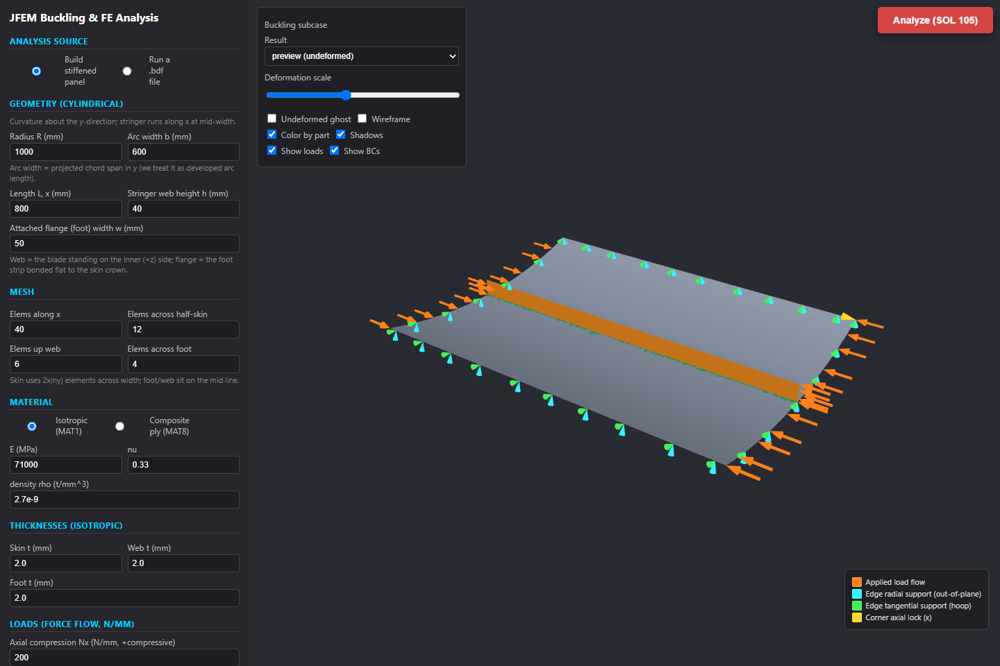

# PANDEATOR — stiffened-panel buckling and sensitivities



PANDEATOR builds a flat or cylindrical skin panel with a longitudinal shell
stringer. It runs native JFEM SOL105 buckling, analytical buckling assessments,
exact discrete adjoints and independent finite-difference checks. One canonical
physical model supplies the preview, downloaded deck and calculations.

## 1. Install and open

1. Follow the [illustrated installation guide](<../../__Start here!__/README.md>).
   Run the repository-root setup launcher. All apps share the root Julia environment.
2. Double-click `Windows/PANDEATOR.cmd`, run `bash Linux/PANDEATOR.sh`, or open
   `Mac/PANDEATOR.command`.
3. Wait for `http://127.0.0.1:8088/`. Keep the terminal open. First use may
   compile Julia code; later requests reuse the running process.
   Opening the page prepares the preview only; it starts no hidden FE analysis.
4. Stop with Ctrl+C. Use `--port 8090` or `--no-open` when needed.

Launchers honor `JFEM_JULIA` and use a shared sysimage only when its provenance
matches the runtime and sources. **Normal setup automatically reuses/builds the
image when resources permit and falls back if memory is insufficient or the
build fails.** All PANDEATOR features run without one. First use may compile,
then the running server retains compiled methods. No separate PANDEATOR packages
are needed.
For manual execution from the repository root:

```sh
julia --project=. --threads=auto APPS/PANDEATOR_APP/panel_launch.jl
```

Open the app through the local server, including preview and deck download.
Opening the HTML as `file://` does not provide the canonical model service.
Browser libraries and shader compilers are bundled for offline use after setup.
Rendering prefers WebGPU and falls back to WebGL.
[Library versions and licenses](vendor/provenance.json).

## 2. Build, assess and differentiate

1. Select **Build stiffened panel**. Enter length, developed skin width, radius
   (`0` means flat), actual blade height and attached-flange width.
2. Choose isotropic or laminate properties. Units are **mm, N, MPa** and density
   **tonne/mm³**. The mass report also provides kg.
3. Choose mesh subdivisions and supports. Preview the model; inspect support
   markers, combined-flange region, mass and load balance. Download the exact BDF.
4. Enter limit-load flows Nx, Ny, Nxy in **N/mm** and the positive buckling-policy
   factor (default **1**). Set the number of FE modes requested.
5. Run **Analyze** for SOL105 and viewer results, or the analytical assessment
   for a static preload and local checks. Analytical-only work requests no FE
   eigenproblem.
6. Read each response's method, assumptions and status. FE load factors and local
   analytical checks describe different idealizations and need not agree.
7. Select gauge variables and run adjoints. Tables show dimensional derivatives
   and normalized values `p/q × dq/dp`. Positive values mean increasing that
   variable increases the RF locally.
8. Run independent finite-difference validation. Start with a small mesh and few
   variables: each variable and step needs two additional complete analyses.
   Two relative steps test step-size stability.
9. Export responses, sensitivities and validation to CSV or JSON. The progress
   log identifies preload, eigenanalysis, adjoints, perturbations and export.
   Cancellation takes effect between numerical operations; a native factorization
   must finish before the solver is released.

Results become stale after parameter edits. The derivative mode count is separate
from the number requested for ordinary FE analysis.

## 3. Physical mesh and attached flange

The x-axis follows the stringer. The skin cross-section lies in y–z and is
parameterized by developed arc coordinate s. The inward normal at the crown
points along +z. Mesh rails include both flange edges and the crown exactly.
The web, skin and combined flange share conforming nodes.

The attached flange is **not a separate coincident shell**. Covered skin is
replaced by one combined property:

- Same isotropic material, centered reference: PSHELL thickness is skin plus
  added-flange thickness.
- Laminate, mixed material or offset construction: PCOMP explicitly contains the
  skin layers followed by the added-flange layers at their physical depths.
- With inward offsets enabled, the original skin reference is retained and the
  added flange grows inward. Otherwise the combined thickness is centered.

Blade height is measured from the skin reference line. Gauge changes do not
move the mesh or silently redefine that height. Zero flange width gives a blade
only. Zero blade height gives a doubler/bare plate, removes the fictitious center
support, and omits column and blade criteria.

Laminate notation is expanded on the server into explicit plies:

| Input | Expanded angles |
|---|---|
| `(45/-45/0/90)S` | 45, −45, 0, 90, 90, 0, −45, 45 |
| `(45/-45/0/90)$` | 45, −45, 0, 90, 0, −45, 45 |
| `(45/-45/0/90)` | 45, −45, 0, 90 |
| `2(45/-45)` | 45, −45, 45, −45 |

## 4. Supports and loads

Each transverse station has a rectangular CORD2R displacement frame: local 1 is
the outward skin normal, 2 the skin tangent, and 3 axial x. This remains defined
at the web, avoiding a cylindrical-axis singularity.

Default simple supports constrain skin-perimeter normal displacement. At both
axial ends, web displacement normal to the web is restrained (local direction 2).
Axial motion and rotations remain free except for the rank-minimal anchors.
Only the additional independent in-plane
anchors needed to remove rigid motion are added. The report lists actual
constraints and rigid-mode rank. The entire perimeter is not locked tangentially,
so membrane shear and Poisson deformation remain possible. A clamped option is
also available and its actual constraints are reported.

- **Nx** means total axial compression `Nx × developed skin width`. Balanced end
  forces are distributed over the physical section using actual tributaries and
  axial laminate stiffness. Gauge changes maintain the total but change its
  partition.
- **Ny** is basic-Y compression at the two side edges. On curved panels this is
  not pure hoop flow or a radial pressure prescription.
- **Nxy** applies consistent axial/side tractions of a shear resultant. Integrated
  curved edge vectors and traction signs balance total force and moment.

Loads act at reference mesh nodes. Offsets can produce eccentric preload bending.
No neutral-axis platen or compensating moments are inserted implicitly. Zero-load
preview is valid; SOL105 requires a nonzero preload and inserts no hidden unit load.

## 5. Analytical calculations and RFs

Demand comes from native recovered membrane resultants and section forces.
The implementation reuses Boxer's plate and section kernels.

| Check | Idealization |
|---|---|
| Skin | Left/right compartments beside a web; one full-width plate without a web. Simply supported double-sine Ritz plate under biaxial compression and shear. |
| Blade | Free-edge web instability: isotropic outstand coefficient 0.425 or orthotropic free-edge Ritz assessment. |
| Column | Pinned flexural Euler column, including full blade, full added flange and half of each adjacent skin panel. Maximum compressive recovered section demand along x governs. |

Plate bending uses the membrane-free stiffness `D* = D − Bᵀ A⁻¹ B`.
Associated column skin spans `−b/4 ≤ s ≤ b/4`; its overlap with the full added
flange is counted once. Actual layer depths enter centroid and bending stiffness.
The column's flexural load is `Pcr = π²(EI)weak/(K L)²`, with pinned `K = 1`.

All RFs are critical limit-load multipliers divided by the buckling-policy factor.
With policy 1, buckling at limit gives RF 1. With policy 1.5, raw multiplier 1.5
gives RF 1. SOL105 raw λ is separately retained and used in the mode viewer.
No destabilizing demand uses the explicit 999 sentinel. Finite values above 999
are displayed as 999 while their uncapped values remain in derivatives/exports.

Curved skins use equivalent local flat plates. Euler covers flexural column
buckling, not torsional, distortional or warping instability. Homogenization,
support lines and equivalent membrane states are approximations. These checks
are not asserted to be globally conservative relative to every curved/clamped FE
model. Review the assumptions attached to each response.

## 6. Adjoint equations and verification

Variables are isotropic gauges `tSkin, tWeb, tFoot` in mm, or dimensionless
laminate scales `scaleSkin, scaleWeb, scaleFoot`. Inactive components are omitted.
Nodes, connectivity, materials and support topology stay fixed for these
derivatives. Geometry edits require rebuilding and are not gauge adjoints.

Static equilibrium is `K(p)u = f(p)`. For an analytical response q(u,p):

```text
Kᵀ ψ = q_u
dq/dp = q_p + ψᵀ(f_p − K_p u).
```

For a simple eigenpair `(K + λ Kg(u,p))φ = 0`, let
`c = φᵀ Kg φ`, `a = ∂[φᵀ Kg φ]/∂u`:

```text
Kᵀ ψ = a
dλ/dp = −[φᵀ(K_p + λ Kg,p|u)φ + λ ψᵀ(f_p − K_p u)]/c.
dRF/dp = (dλ/dp)/buckling-policy factor.
```

The load derivative f_p is included because fixed total end load is partitioned
by stiffness. Constitutive, ply, offset and recovery derivatives use production
operators. Geometric-stiffness replay is checked against the forward operator.
Finite differences are never substituted for a reported adjoint.

Validation independently rebuilds and solves p+h and p−h:

```text
FD = [q(p+h) − q(p−h)]/(2h).
```

The table reports two steps, dimensional derivatives, relative/absolute error,
step stability, matched modes and translational MAC. Residuals and spectral gaps
are retained. Reordered modes are matched rather than compared blindly by index.
Repeated eigenvalues, unequal tied controlling sections and other nonsmooth
cases have explicit statuses; they must not masquerade as unique-gradient passes.
Missing/no-demand/unavailable rows remain in coverage totals.

A useful check is a thin bare isotropic plate under fixed force flow:
`λcr ∝ t³`, hence `dλ/dt = 3λ/t`. The `2λ/t` rule corresponds to fixed
stress and does not describe this loading.

Theory: [NACA TN 3781, Handbook of Structural Stability, Part I](https://ntrs.nasa.gov/citations/19930084505)
for plates; [Townsend and Kim (2019)](https://link.springer.com/article/10.1007/s00158-019-02374-9)
for shell buckling adjoints and geometric-stiffness preload dependency.

## 7. Existing decks

Select **Run a .bdf file** and enter a path accessible to the Julia server.
SOL101/103/105/106 is detected from the deck. INCLUDE paths resolve beside the
original file; the input is not moved. Its own extraction settings apply.
Generated-panel analytical/gauge catalogs do not automatically map to arbitrary
imported models. The result-file selector preserves separate SOL105 subcases and
their matching static preloads.

## 8. Artifacts and implementation

Each request has a unique directory under `output/panel_runs/`. Override the
parent with `JFEM_PANEL_RUN_ROOT`. The app reports actual output and baseline
BDF paths. Runs save the request, baseline SOL101/SOL105 deck, numerical responses,
diagnostics and assessment report. Validation retains independent perturbed
decks/results. Ordinary Analyze exports viewer binaries/full-field JSON;
derivative/validation work avoids these large exports by default.

| File | Responsibility |
|---|---|
| `panel_model.jl` | Canonical topology, properties, loads, supports, mass, BDF and preview. |
| `panel_analysis.jl` | Native preload/eigenanalysis, analytical criteria, adjoints, independent FD. |
| `panel_workflow.jl` | Serialized jobs, progress/cancel, compact reports and exports. |
| `panel_server.jl` | Local HTTP/MessagePack and existing-deck execution. |
| `panel_app.html`, `panel_workflow.js`, `panel_workflow.css` | Forms, canonical preview, response/gradient/validation tables and viewer. |
| `panel_launch.jl` | Platform launch and browser opening. |

The browser has no duplicate FE generator. Numerical jobs share one solver lock.
All calculations use the root OpenJFEM and Boxer packages.
