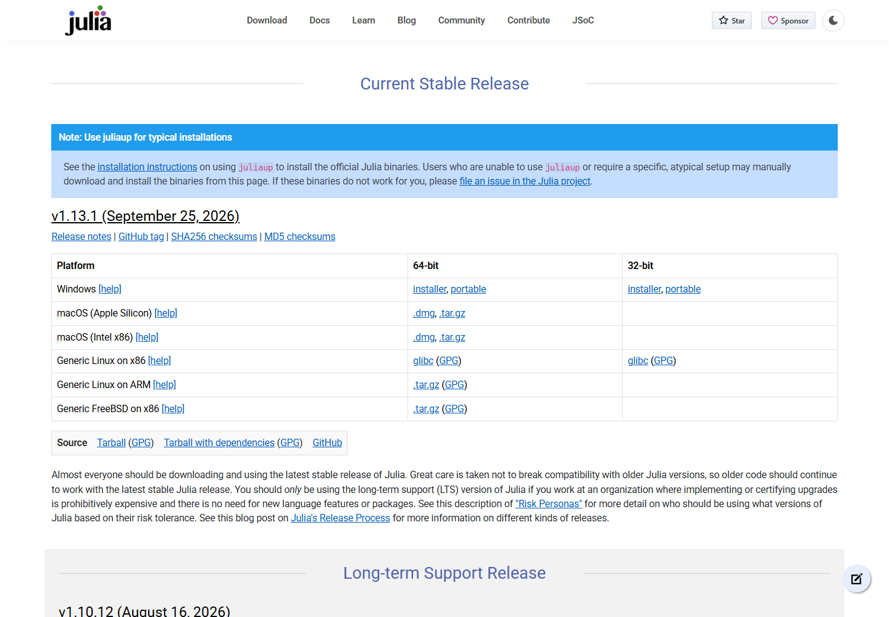
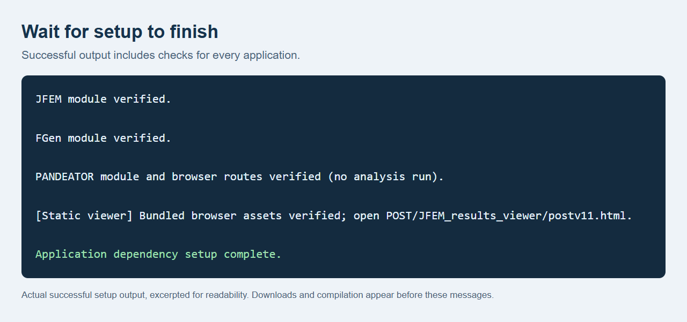
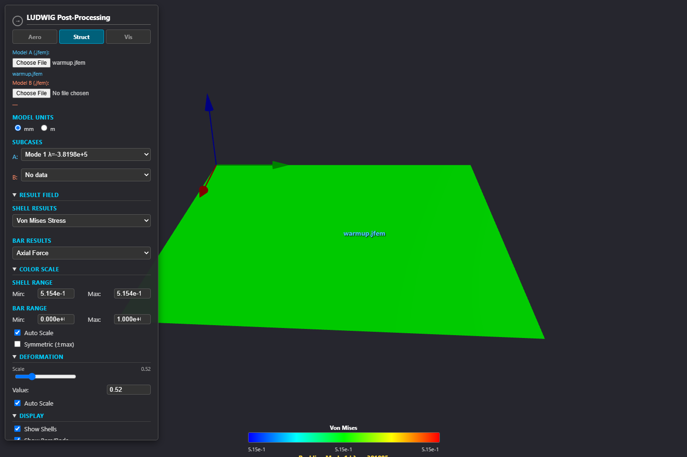

# Install JFEM and open your first application

Follow the numbered steps below. One installation prepares **JFEM, FGen,
PANDEATOR and the results viewer**. You do not need to install individual Julia
packages, Python or Node.js.

[Download the illustrated PDF](jfem_2026_installation_guide.pdf) |
[Advanced setup and sysimages](ADVANCED_SETUP.md)

The main steps show Windows. [macOS/Linux commands](#macos-and-linux) are at the end.

## 1. Install Julia

1. Open [Julia's manual downloads page](https://julialang.org/downloads/manual-downloads/).
2. Find **Julia 1.13.1**, the version recorded and tested by this checkout. For a typical Windows PC, click the **64-bit installer** in the **Windows** row.
3. Open the downloaded installer, choose an installation folder and click **Next**.
4. Tick **Add Julia To PATH**, then finish the installation. Close any terminal windows opened before installation.

The PATH option lets the JFEM launchers find Julia. See Julia's
[Windows installation instructions](https://julialang.org/downloads/platform/#windows)
if the installer looks different. If you already use Juliaup, follow the
[short runtime-selection instructions](ADVANCED_SETUP.md#runtime-and-project-selection).



*Julia's [official download page](https://julialang.org/downloads/manual-downloads/). Choose the installer for your operating system.*

## 2. Download and extract JFEM

1. Open the [JFEM repository](https://github.com/r-acad/JF_2026_05_25).
2. Click the green **Code** button, then **Download ZIP**.
3. In Downloads, right-click the ZIP and choose **Extract All**.
4. Open the extracted folder. If it contains another folder, open that too until you can see **setup.cmd**, **WingFEGen**, **POST** and **JFEM_installation** together.

Keep these folders together. The folder containing `setup.cmd` is the
**repository root** used in the next steps. Do not launch files from inside the ZIP.


*Click Code, then Download ZIP. Extract the complete download before continuing.*

## 3. Start the automatic setup

1. In the repository folder, click the File Explorer **address bar**.
2. Type **powershell** and press **Enter**. A terminal opens in that folder.
3. Copy the following command into the terminal and press **Enter**:

```powershell
.\setup.cmd
```

Setup downloads and installs the required packages for all four applications.
It also compiles Julia packages and checks the applications. Stay connected to
the internet and keep the terminal open.


*Folder map: run setup.cmd from the top folder. The application files remain in their subfolders.*

## 4. Wait for setup to finish

The first setup can take several minutes. Messages and pauses during compilation
are expected; do not close the window while setup is running.

When the checks finish, look for:

```text
Application dependency setup complete.
```

The terminal then prints the launch commands and returns to its prompt. You can
now open an application. If it reports **Package setup failed** or an error,
keep the message and use [Help if something stops](#help-if-something-stops).



*Typeset excerpt from a successful setup run. The completion line confirms that all four application checks finished.*

## 5. Open the application you need

| To do this | Open this folder and file on Windows |
| --- | --- |
| Build lifting-surface models, run analyses and inspect results in **FGen** | Open `WingFEGen`, then double-click `run_fe_generator.cmd`. |
| Build and analyze a stiffened panel in **PANDEATOR** | Open `POST`, then `PANDEATOR_APP`, and double-click `RUN_PANDEATOR_WINDOWS.cmd`. |
| View an existing **.jfem** result file | Open `POST`, then `JFEM_results_viewer`, and double-click `postv11.html`. |
| Run **JFEM** directly on an input deck | Use the terminal example in step 6. |

FGen normally opens `http://127.0.0.1:8080`; PANDEATOR normally opens
`http://127.0.0.1:8088/`. Wait for the browser to open. Keep the application's
terminal open while you work; **Ctrl+C** stops its server.

In FGen, choose **Start new study** to begin. Follow the
[illustrated FGen guide](../Reference_documentation/00_Getting_Started/jfem_2026_fgen_user_guide.pdf)
for modeling, analysis and results. For panels, see the
[PANDEATOR guide](../POST/PANDEATOR_APP/PANEL_APP_README.md).


*FGen's first screen: choose Start new study to create a model.*


*PANDEATOR opens with a panel preview. Its left-hand controls define the geometry, mesh, materials and loads.*

The static results viewer needs no server. Select its **Struct** tab, then click
**Choose File** under **Model A (jfem)** and open a `.jfem` result. Keep the
surrounding `POST` folders in place. Step 6 creates a small result to try.

## 6. Try the standalone solver (optional)

The repository includes a tiny model, so you do not need to prepare a deck.
In the same PowerShell window opened in step 3, run these two commands:

```powershell
$deck = 'JFEM_installation\examples\precompile\sol101_quad_static.bdf'
.\jfem.cmd $deck output\installation_smoke
```

When the run finishes, open **output**, then **installation_smoke**, in File Explorer.
The folder contains a `.jfem` result, a report and results JSON. Open the `.jfem`
file in the static viewer from step 5. A first solve may compile additional Julia
methods even after setup has finished.



*The static viewer after loading a small bundled-model result. Use Struct, then Choose File, to load your own .jfem output.*

## 7. Make repeated startup faster (optional)

A local **sysimage** stores compiled solver methods. To build one later, return
to the repository's PowerShell window and run:

```powershell
.\setup.cmd --sysimage
```

This is optional. It can take substantial time and memory and does not remove
all future compilation. The image covers JFEM and PANDEATOR; FGen's solver jobs
can use it, but its separate application server is not included. Launchers use
it only while its recorded source/runtime checks still match.

Use the [sysimage instructions](ADVANCED_SETUP.md#build-an-optional-sysimage)
for rebuilds, the double-click build files and other options. Normal setup and
the applications work without an image.

## macOS and Linux

Use the same repository ZIP and keep the extracted folders together. Install
Julia using the [official instructions](https://docs.julialang.org/en/v1/manual/installation/),
then open a new terminal in the extracted repository folder.

| Step | Command or action |
| --- | --- |
| Install application packages | `bash setup.sh` |
| Open FGen | `julia --startup-file=no --project=WingFEGen WingFEGen/run.jl` |
| Open PANDEATOR | `bash POST/PANDEATOR_APP/RUN_PANDEATOR_MAC_LINUX.sh` |
| Open the static viewer | Open `POST/JFEM_results_viewer/postv11.html` in your browser. |
| Optionally build a sysimage later | `bash setup.sh --sysimage` |

For the standalone example:

```bash
deck='JFEM_installation/examples/precompile/sol101_quad_static.bdf'
bash jfem "$deck" output/installation_smoke
```

If your Julia version differs from the recorded 1.13 release line, use
[explicit runtime selection](ADVANCED_SETUP.md#runtime-and-project-selection).

## Help if something stops

| What you see | What to do |
| --- | --- |
| **Julia was not found** | Finish the Julia installer with **Add Julia To PATH**, then reopen the terminal. |
| A message about the Julia version | Use the recorded release line shown by setup; see [runtime selection](ADVANCED_SETUP.md#runtime-and-project-selection). |
| Package download or network error | Keep the error message, restore network/proxy access and run setup again. Completed downloads are reused. |
| The browser cannot connect | Wait for the app's terminal to report readiness and use its printed address. Keep that terminal open. |
| The viewer has no model | Select a `.jfem` file and keep the complete `POST` folder structure. |

More options: [advanced setup and repair](ADVANCED_SETUP.md),
[offline preparation](OFFLINE_DEPENDENCIES.md),
[documentation index](../Reference_documentation/README.md).
