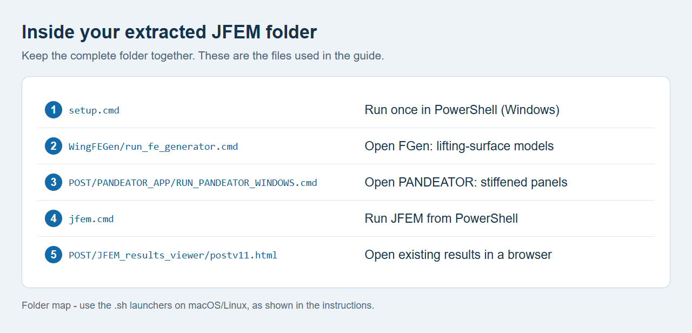

# Installation illustrations

These images support the [numbered installation guide](../INSTALLATION.md).

| Image | Origin |
| --- | --- |
| `julia-download.png` | Actual [Julia manual-downloads page](https://julialang.org/downloads/manual-downloads/), captured 14 October 2026. The website's [MIT copyright and permission notice](julia-website-LICENSE.txt) is included alongside the screenshot. |
| `github-download.png` | Actual public repository page with **Code > Download ZIP** open, captured 14 October 2026. |
| `launch-files.png` | Folder map drawn from the repository's verified launch-file paths. It is an illustration, not an Explorer screenshot. |
| `setup-complete.png` | Typeset excerpt from a successful four-app dependency setup log. It illustrates the completion messages, not a new sysimage build. |
| `fgen-start.png`, `fgen-model.png` | Actual FGen screenshots using the synthetic model from the user's guide. |
| `pandeator.png` | Actual running PANDEATOR interface with its default model, captured 14 October 2026. |
| `results-viewer.png` | Actual structural-results viewer with a tiny startup demonstration result, captured 14 October 2026. |

