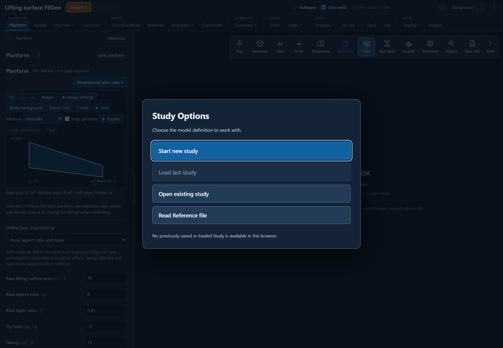

# Getting started with JFEM and its apps

1. [Illustrated installation](../../JFEM_installation/jfem_2026_installation_guide.pdf): install Julia,
   download the complete repository, install all application dependencies,
   optionally build a solver sysimage, and verify the command-line and browser apps.
2. [FGen user's guide](jfem_2026_fgen_user_guide.pdf): learn the model-generation,
   analysis, sensitivity and results workflows with screenshots from the app.

For copyable commands, see the [installation walkthrough](../../JFEM_installation/INSTALLATION.md).
The repository-root `setup.cmd` (Windows) or `bash setup.sh` (macOS/Linux) is
the shared setup entry point. A sysimage is optional; the walkthrough explains
what it accelerates and when to rebuild it.

For further theory and application references, see the [documentation index](../README.md).

