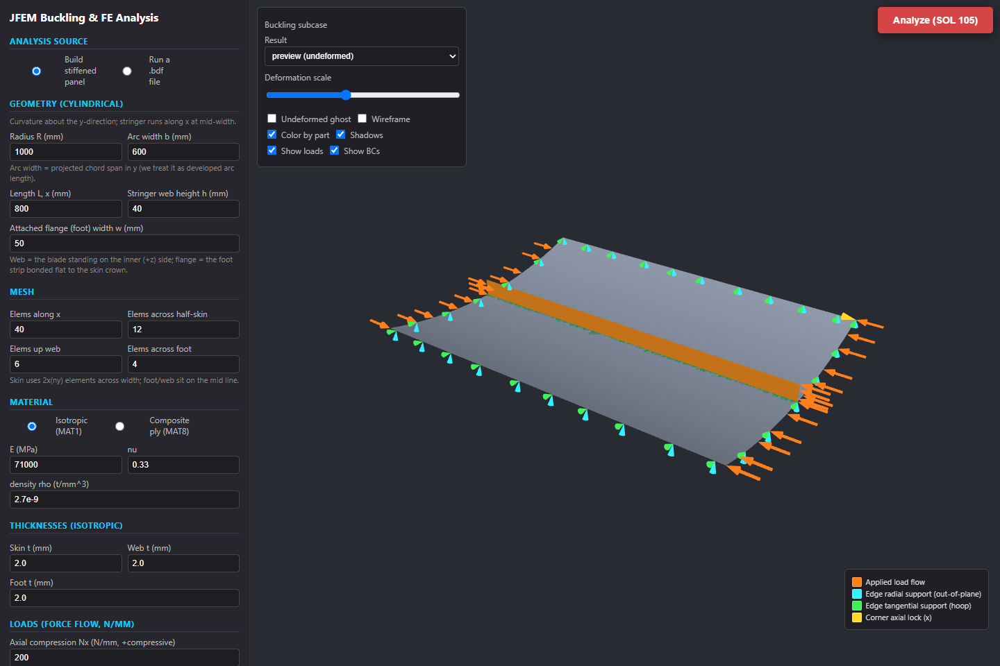

# Buckling exercises

1. [Original aircraft-design buckling assignment (PDF)](Linear_Finite_Elements_Buckling_exercises_AV_AC_DES_26.pdf).
   The supplied 20-page document is preserved unchanged, including its original
   screenshots, links and instructions. It covers Julia installation, PANDEATOR,
   isotropic and composite panel sizing, and questions about boundary conditions.
2. [Maintained JFEM linear-buckling exercise (PDF)](jfem_2026_linear_buckling_exercise.pdf).
   A companion exercise for the repository's solver and panel workflow.

For this checkout, start with the current
[illustrated installation guide](../../JFEM_installation/jfem_2026_installation_guide.pdf)
or [numbered instructions with copyable commands](../../JFEM_installation/INSTALLATION.md).
The original assignment's older download links and installation process have
deliberately been retained as reference material.

This image shows the current app; the original PDF above has not been edited.
