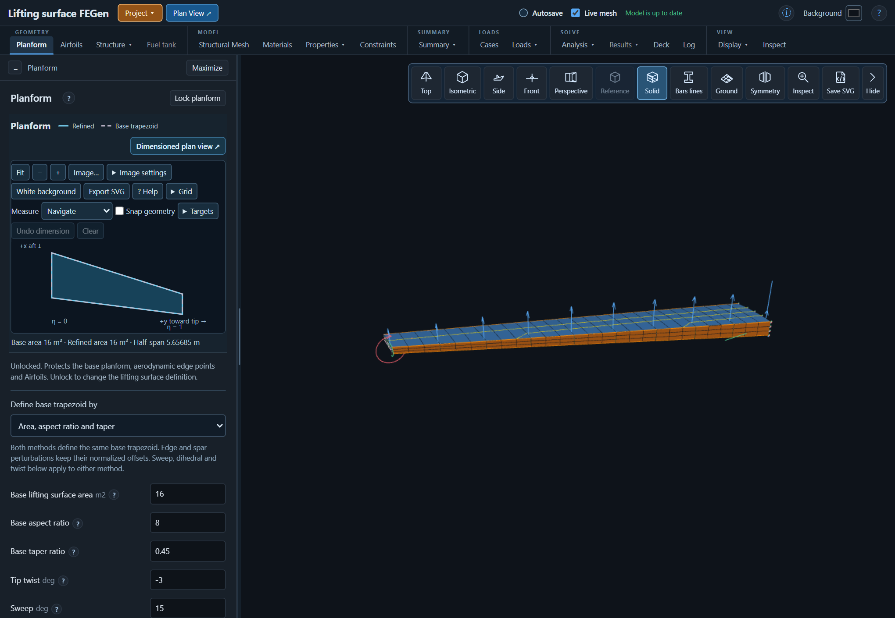

# JFEM documentation

| Guide | Contents |
| --- | --- |
| [Illustrated installation (PDF)](../JFEM_installation/jfem_2026_installation_guide.pdf) | Follow numbered steps to install Julia, download JFEM, run setup and open each app; optional sysimage instructions follow. |
| [FGen user's guide (PDF)](00_Getting_Started/jfem_2026_fgen_user_guide.pdf) | Illustrated workflow for studies, geometry, meshes, properties, loads, analyses, results, sensitivities and display controls. |

An [installation walkthrough in Markdown](../JFEM_installation/INSTALLATION.md)
provides copyable commands. The [app README](../WingFEGen/README.md) and
[sensitivity method notes](../WingFEGen/SENSITIVITY_METHOD.md) describe current
features and limitations.

Installation files and the printable guide are together in
[JFEM_installation](../JFEM_installation/). The FGen guide remains in
[Getting Started](00_Getting_Started/).
Further references are organized by topic:

- [User reference](01_User_Reference/)
- [Solver architecture](02_Solver_Architecture/)
- [Formulation and sensitivities](03_Formulation_and_Sensitivities/)
- [TACS backend](04_TACS_Backend/)
- [Exercises](07_Exercises/)

The [original illustrated buckling assignment](07_Exercises/Linear_Finite_Elements_Buckling_exercises_AV_AC_DES_26.pdf)
is preserved unchanged for reference. Its historical download links and installer
instructions remain as supplied; use the current installation guide above for
this checkout.

Screenshots in the user's guide were captured from the running app using a
synthetic example. These guides accompany the October 2026 interface; their
filenames remain stable for links.
