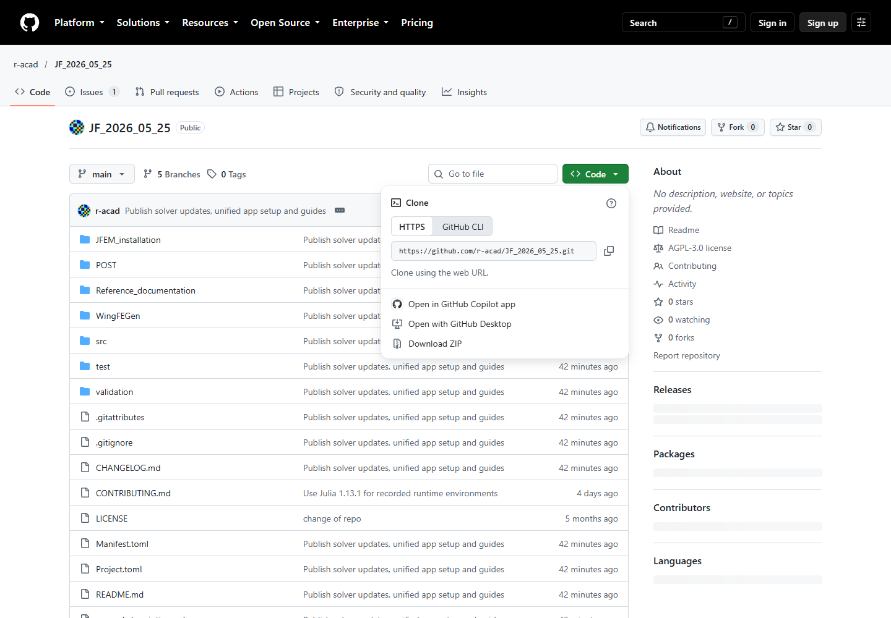
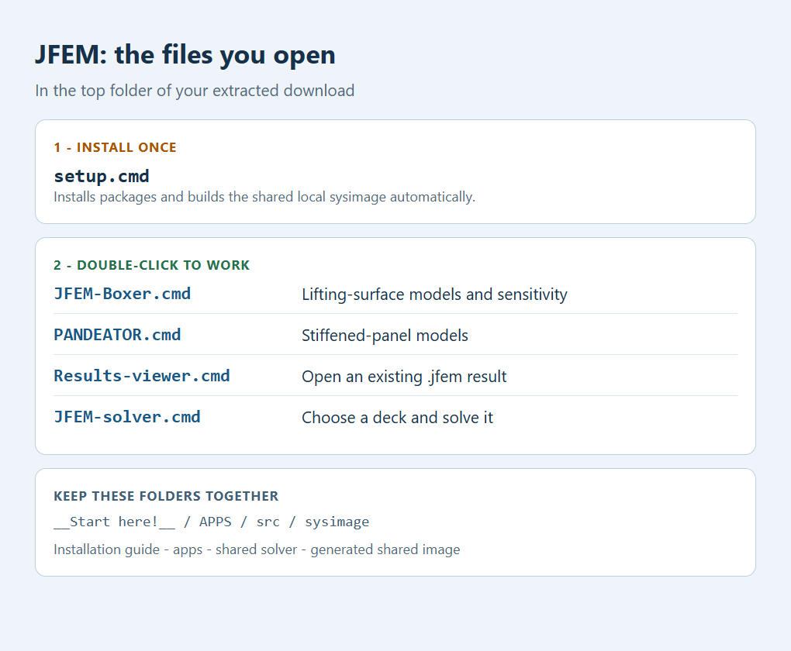
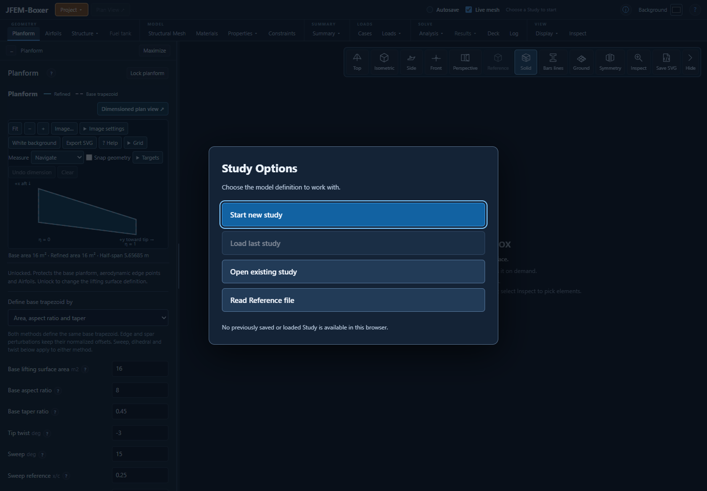
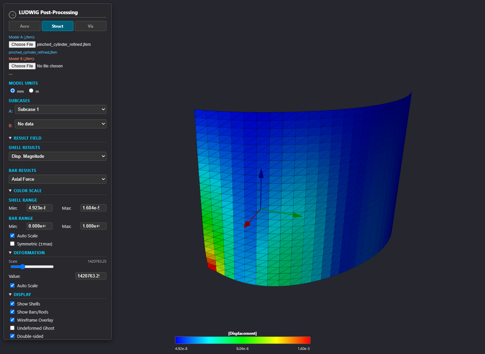

# Install JFEM and launch the apps

One setup prepares **JFEM-Boxer, JFEM, PANDEATOR and the results viewer**, including
a shared compiled Julia sysimage. You do not need to install packages individually or
enter Julia commands to launch the Windows applications.

[Illustrated installation PDF](jfem_2026_installation_guide.pdf) |
[Advanced setup and repair](ADVANCED_SETUP.md)

## 1. Install Julia / add it to PATH

1. Open [Julia downloads](https://julialang.org/downloads/manual-downloads/).
2. Download the Windows 64-bit installer for **Julia 1.13.1**, the version tested
   with this checkout (or a compatible patch of the same release line).
3. Run the installer. **Tick "Add Julia to PATH". This is required for the
   double-click launchers to find Julia.** Finish installation.
4. Close and reopen any terminal or File Explorer windows opened before installation.

If you missed the PATH checkbox, rerun/modify the installation or follow the
[official Windows instructions](https://julialang.org/downloads/platform/#windows).
Juliaup users can select the recorded runtime as described in [advanced setup](ADVANCED_SETUP.md).

## 2. Download and extract the complete repository

1. Open [JFEM on GitHub](https://github.com/r-acad/JF_2026_05_25).
2. Click **Code / Download ZIP**.
3. Right-click the downloaded ZIP and select **Extract All**.
4. Open the extracted folder until you see **setup.cmd**, **JFEM-Boxer.cmd**,
   **APPS** and **__Start here!__** together. Do not run files from inside the ZIP.

Keep the whole folder together. App launchers depend on the shared solver and
assets beside them. Choose a writable location on your computer.

## 3. Double-click setup.cmd once

Stay connected to the internet. Setup finds Julia, installs all required packages,
checks the apps and **automatically builds one shared local sysimage** for
JFEM, JFEM-Boxer and PANDEATOR. All use the root Project/Manifest and the same
package versions. Building this image is the slow part of installation and can
take an hour or longer on the first installation. During machine-code generation,
the console may be quiet for an extended period. Keep the window open until
setup reports completion.
The progress messages distinguish package installation, precompilation, workloads
and image construction. A repeated setup reuses current images.

If setup fails, keep the error text and run it again after fixing the reported
problem. Completed downloads are reused. There is no need to type `using Pkg`
or manage a package list. `--no-sysimage` is an advanced opt-out, not the normal install.

## 4. Double-click the app you need

All Windows launchers are in the top folder:

| File | What opens |
| --- | --- |
| **JFEM-Boxer.cmd** | Lifting-surface modeling, loads, FE analyses, sensitivity and results. |
| **PANDEATOR.cmd** | Stiffened-panel modeling and analysis. |
| **Results-viewer.cmd** | Viewer for an existing `.jfem` result file; no Julia server needed. |
| **JFEM-solver.cmd** | File chooser for a `.bdf`, `.dat` or `.nas` input, then standalone JFEM. You may also drop a deck onto this file. |

JFEM-Boxer and PANDEATOR open a local browser page. Keep their console windows
open while you work. The console prints the address if your browser does not open
by itself. Close the app or press **Ctrl+C** in its console when finished.

JFEM-Boxer starts with **Study Options**. Choose **Start new study**, then use
**Project** to save or open studies. See its
[illustrated user guide](../Reference_documentation/00_Getting_Started/jfem_2026_fgen_user_guide.pdf).

## 5. Run a model and inspect its results

In JFEM-Boxer, define the model and loads, create its mesh, then use
**Analysis / FE Analysis**. Select a solution and **Run in JFEM**. Results stay
in the app. **Analysis / Sensitivity** provides response and design-variable selection.

To try the standalone solver, double-click **JFEM-solver.cmd** and choose
`__Start here!__/examples/precompile/sol101_quad_static.bdf`. The console reports
where it wrote the results. Open **Results-viewer.cmd**, choose **Struct / Choose
File** for Model A, and select the resulting `.jfem` file. Choose a case, displacement
or stress contour and deformation scale. The viewer does not run analyses.

*Worked example: the public refined pinched-cylinder model (576 shells),
displacement magnitude and mesh edges. The legend gives the actual values; the
automatic deformation amplification is only a visualization setting. The
smaller bundled setup model is a separate example.*

## The shared sysimage is selected automatically

The launchers check the Julia version, source, package manifests and image receipt.
**JFEM-Boxer, its analysis/sensitivity workers, PANDEATOR and standalone JFEM
load the same shared image.** The console
states the selected image. This avoids repeating the compilation covered by the
installation workloads. A new element type, response or code path may still
compile the first time it is used.

After updating source, Julia or dependencies, rerun **setup.cmd**. Never force an
old sysimage with `-J`: it contains a compiled copy of the previous code. If an
image is missing or stale, launchers report this and use a valid source startup.

## macOS and Linux

Use the same folder layout. Install Julia and make `julia` available on PATH.
Run `bash setup.sh` once; it installs packages and builds the shared image automatically.
Run `bash JFEM-Boxer.sh`, or open **JFEM-Boxer.command** on macOS. PANDEATOR starts
with `bash APPS/PANDEATOR_APP/RUN_PANDEATOR_MAC_LINUX.sh`. Open
`APPS/JFEM_results_viewer/postv11.html` for existing results.
Standalone: `bash jfem path/to/model.bdf`.

## Help if something stops

| Message or symptom | Action |
| --- | --- |
| Julia not found | Install Julia with **Add Julia to PATH**, then reopen the launcher. |
| Package download error | Restore network/proxy access and rerun setup. |
| Image missing, stale or incompatible | Rerun setup; retain the source/runtime checks. |
| Browser cannot connect | Wait for the console's ready message and open its printed address. |
| Empty results viewer | Use Struct / Choose File and select a `.jfem` output. |
| A Study error remains on screen | Use **Close** to acknowledge it; the details remain in Log. |

More: [advanced setup](ADVANCED_SETUP.md), [offline preparation](OFFLINE_DEPENDENCIES.md),
[documentation index](../Reference_documentation/README.md).
