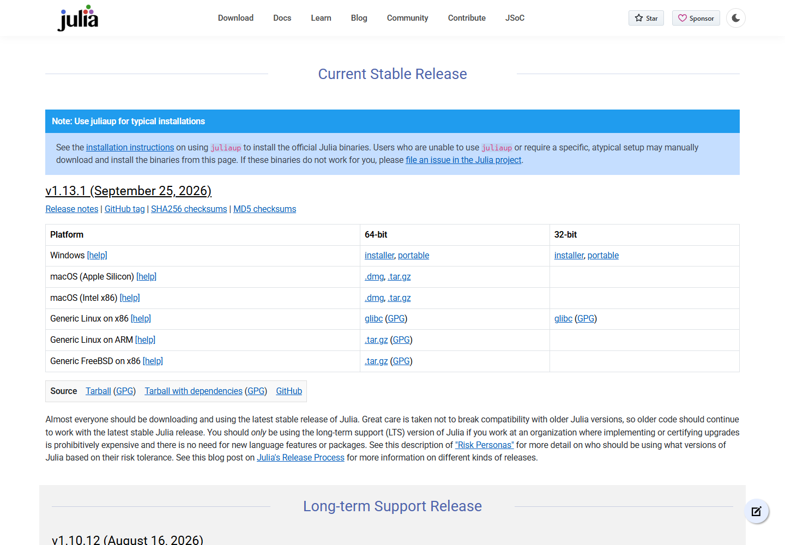

> **Setup must run first.** From the repository root, run `setup.cmd`. All applications share these packages. Setup handles image builds and low-memory fallback automatically. This folder contains application shortcuts only.

# JFEM on Windows

## Install once

1. Check an existing Julia installation with `julia --version` in a new
   PowerShell window. This checkout records **Julia 1.13.1**; setup accepts the
   **1.13** release line. An existing 1.13.x installation can be reused.
   If Julia is missing, install **Julia 1.13 (64-bit)** from
   [Julia downloads](https://julialang.org/downloads/manual-downloads/).
   **Tick Add Julia to PATH**, then reopen the terminal/File Explorer window.
   For an older Julia installation, see **Repair and updates** below.
2. Download the complete JFEM ZIP from GitHub and choose **Extract All**. Keep
   the entire extracted folder together in a writable location.
3. Open the repository root and double-click **setup.cmd**.
   Stay connected to the internet. It installs the shared packages for JFEM,
   Boxer, PANDEATOR and their workers. It automatically reuses a compatible
   image, or checks available memory and builds one when resources permit.
4. Keep the window open until setup finishes. An image build can take an hour
   or longer. If memory is insufficient or the build fails, setup reports the
   reason and continues without it. Launch the app after successful setup;
   first use may compile Julia code when running without an image.



## Launch an app

Double-click a launcher in this Windows folder:

| File | Opens |
| --- | --- |
| **JFEM-Boxer.cmd** | Lifting-surface modeling, FE analysis, sensitivity and results. |
| **PANDEATOR.cmd** | Stiffened-panel modeling and analysis. |
| **Results-viewer.cmd** | Existing `.jfem` results through a lightweight local server; WebGPU preferred. |
| **JFEM-solver.cmd** | A deck chooser. Dropping a `.bdf`, `.dat` or `.nas` file also works. |

The app-owned launchers are also available in `APPS/<app>/Windows/`. Keep the
Boxer/PANDEATOR/results-viewer console open while using its browser page. Close the app or
press **Ctrl+C** in that console when finished.

The results-viewer server loads only browser assets, not the FE solver. If Julia
is unavailable, its launcher opens the offline WebGL viewer directly. You can
also open `APPS/JFEM_results_viewer/postv11.html` directly for this fallback.

To try the solver, choose `utils/examples/precompile/sol101_quad_static.bdf`.
The console reports the output location. In Results viewer, use **Struct /
Choose File** for Model A and open the resulting `.jfem` file.

Run the setup/repair commands below in PowerShell at the **repository root**:
the folder containing `Project.toml`, `Manifest.toml` and `setup.cmd`.

## Repair and updates

- **An older Julia is already installed:** if you use Juliaup, run
  `juliaup status`, `juliaup add 1.13`, then `juliaup default 1.13`.
  The last command changes the default Julia for your other projects too.
  Reopen PowerShell and check `julia --version` before running `.\setup.cmd`.
  Without Juliaup, install 1.13 alongside the older version using step 1 above.
  Keep your existing Julia installations and package cache. If the old Julia
  still starts, use `where.exe julia` to inspect PATH, or set `JFEM_JULIA` to
  the full matching `julia.exe` path. Do not include `+1.13` or other flags in
  that variable. An old `WINGFEGEN_JULIA` setting can override it for Boxer;
  remove that old setting or point both variables to the same executable.
- **Updating JFEM:** save your Studies, stop the app and update the complete
  repository, keeping your Studies/decks and Julia depot. Run `.\setup.cmd`
  at the updated repository root, then restart the app and reload the browser.
  Setup reuses cached packages and checks the shared image. A compatible image
  is reused; otherwise setup checks resources and attempts a fresh build.
  Low memory or an image-build failure selects normal Julia loading. First use
  after source/package updates may compile when using this fallback.
- **Julia not found:** put the tested Julia executable on PATH and reopen the
  terminal or launcher. `JFEM_JULIA` can name its full executable path without flags.
- **Download failure:** restore network/proxy access and rerun setup; completed
  downloads are reused. Keep the error text if it fails again.
- **Image missing or stale:** the app runs through normal Julia loading. No
  rebuild is needed to use it. Launchers check compatibility before loading
  an existing image. Do not force an old image with `-J`.
- **Image build skipped or failed:** setup reports the reason and continues
  without the image. This is a usable installation; launch the app normally.
  If package installation or verification fails, fix that separate error before
  launching. Do not force a stale image with `-J`.
- **Browser cannot connect:** wait for the console's ready message, then open
  its printed local address. Keep that console open while using the app.

`.\setup.cmd --dry-run` shows the setup plan. Ordinary package
precompilation defaults to one task; this does not limit analysis threads. Do not delete your studies or decks
to repair an installation. See the [solver reference](../../utils/julia_tools/README.md)
for batch commands and representative precompile workloads.

The generated image (`sysimage/OpenJFEM_sysimage.dll` on Windows, `.so` on
Linux or `.dylib` on macOS) is local installation output. It is not included
in GitHub: it depends on the operating system, Julia version, CPU and source
revision. Setup handles its reuse/build automatically; launchers check the
receipt and run without it when unavailable.

## Automatic image build and fallback

Normal setup requires no image-build decision. It reuses a compatible image
first, checks available RAM before a new build, and keeps memory headroom while
building. Insufficient or unknown memory, or an image-build failure, selects
ordinary Julia loading and setup continues. The console explains which mode is
ready. This automatic check is a resource safeguard, not a guarantee of a fixed
peak-memory requirement.

All applications provide the same features without an image. Initial startup
and the first calculation may compile Julia code; later requests reuse the
running process and normal package caches.

To intentionally skip image construction, the explicit option is:

```powershell
.\setup.cmd --no-sysimage
```

`--sysimage` remains supported and `--sysimage-threads=1` limits build
concurrency. Neither removes the automatic memory checks or guarantees a low RAM
peak. Set `JFEM_NO_SYSIMAGE=1` in the launch environment to force ordinary
package loading even when an image exists.

## Offline use

1. On a connected computer with the same OS, architecture and Julia release,
   complete normal setup for this checkout.
2. Copy the complete repository and Julia depot to the offline computer.
   The default depot is `%USERPROFILE%\.julia`; copy the depot named by
   `JULIA_DEPOT_PATH` instead if you set that variable.
3. Install the matching Julia runtime and put it on PATH. Run
   `.\setup.cmd --offline` on the target computer. This uses cached packages and native
   artifacts. Image reuse/build and low-memory fallback are automatic here too.
4. If a package or artifact is missing, repeat setup on the connected computer
   and refresh the copied depot. Keep the pinned Manifest unchanged.

Boxer, PANDEATOR and the results viewer use bundled Babylon.js and browser
libraries, with no CDN downloads or pre-existing browser cache needed. Setup
includes the WebGPU shader compilers. The renderer prefers WebGPU and falls
back to WebGL if needed, reporting the active backend and fallback reason. Setup
verifies their files and checksums, including with `--boxer-only`. Keep the
complete repository together. If setup reports a missing or changed browser
asset, extract a fresh complete copy of the same release; do not copy individual
library files from another release.

Opening local models, solving them and reading `.jfem` results work offline
after Julia setup. Downloading new UIUC airfoils requires internet; locally
imported airfoils and profiles embedded in saved Studies work offline.
Julia packages and images are platform-specific; a cache from another operating
system is not sufficient.

[Illustrated PDF](../jfem_2026_installation_guide.pdf) · [Choose another OS](../README.md)
