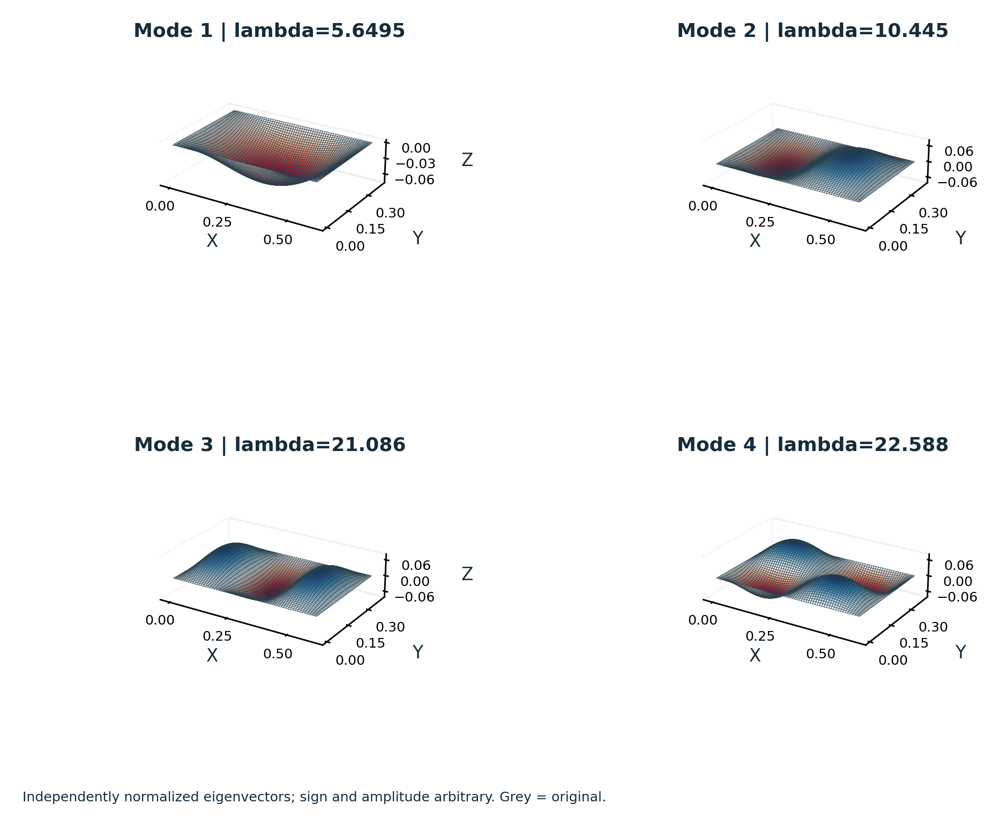
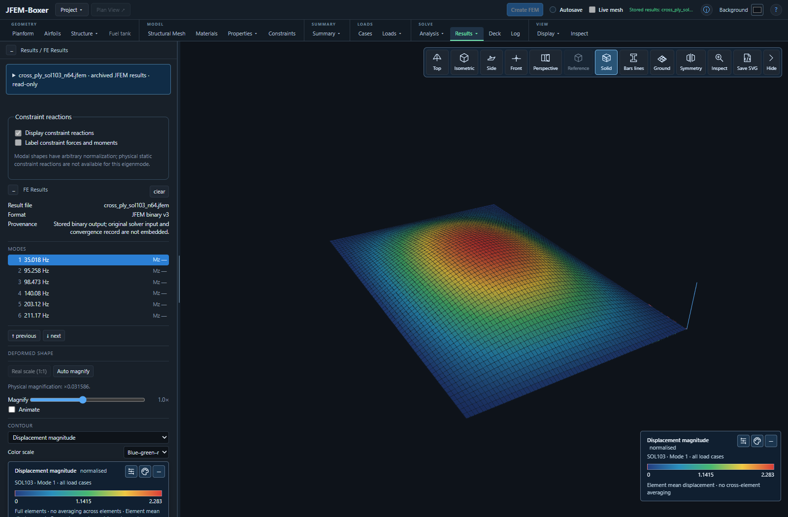

# JFEM validation cases

Explore the **[illustrated case gallery](index.html)**, open a concise case card,
or load the recorded result directly in JFEM-Boxer. The collection contains
**19 case folders: 13 revised existing cases, five analytical case families and
the original published uCRM9 structural study**.
Each includes its model, numerical results, references and reusable PNG/SVG figures.

[Results and limitations](VALIDATION_SUMMARY.md) · [Case inventory CSV](CASE_INVENTORY.csv) ·
[Current comparison table](comparison.md)



## View the results in Boxer

1. Start [JFEM-Boxer](../APPS/JFEM-Boxer/README.md).
2. Choose **Project → Open JFEM results…** and browse to a case's `results` folder.
3. Select a `.jfem` file. Use the result controls to choose its load case,
   normal mode, buckling mode or available static preload.

For example, [ACA01](cases/ACA01/case_card.pdf) provides `results/static.jfem`
and `results/modes.jfem`; [ACA03](cases/ACA03/case_card.pdf) provides
`results/buckling.jfem`. These are recorded solver results and can be inspected
without running the analysis again. Figure captions state displacement
magnification; eigenvector sign and amplitude are arbitrary.



This is the recorded ACA04 result opened from disk; its first frequency is
35.018 Hz. The source model and convergence data remain alongside the result.

The [original uCRM9 study](cases/CRM_uCRM9_published/README.md) compares the
released anisotropic wingbox, masses and loads with 20 author-published
frequencies and a static tip scalar. Its separate report keeps the unresolved
tip observation location explicit. The [CRM Boxer image gallery](cases/CRM_wingbox_modal/figures/boxer/index.html)
provides 16 unedited 4K views of the uniform-shell illustration model, including
properties, internal structure, constraints, translucency and five archived modes.

## What is in each folder?

| File or folder | Contents |
|---|---|
| `case_card.pdf` | Two- or three-page model definition, reference, results and limits |
| `model.bdf` or named author decks | Representative analysis inputs; additional decks cover other solutions or meshes |
| `case.json` | Geometry, materials, constraints, loads, references and documented observations |
| `metrics.csv` | The numerical quantities shown on the card |
| `figures/` | PNG and SVG figures generated from recorded numerical fields |
| `results/` | Native `.jfem` files, numerical tables and reproducibility information |
| `convergence/` | Additional refinement models with retained comparison results |
| `diagnostics/` | Explicitly unqualified diagnostic material where supplied |

Seventeen case folders have an independent analytical or published reference.
The CRM modal model and open-source static patch contain historical regression
targets only. The cylinder strip is an analytical screening case with an
explicit extraction limit. Their classifications remain visible in the cards
and [summary](VALIDATION_SUMMARY.md).

## Reproduce the comparisons

Use the [normal JFEM installation](<../__Start here!__/README.md>); the shared
Julia environment supplies the solver dependencies. On Windows, double-click
**[run_public_validation.cmd](run_public_validation.cmd)**. It creates a new
timestamped folder under `validation/local_runs` and retains the generated results.

From the repository root, the same default check is:

```text
julia --startup-file=no --project=. validation/run_public_suite.jl --output-dir validation/local_runs/my_check
```

This runs **24 representative analyses and compares 44 quantities**, including
the selected nested refinements. The retained cylinder diagnostic is excluded
from qualification. The manifest [public_suite.yaml](public_suite.yaml) specifies
the actual selectors, reference functions and tolerances. Preserve its deck
settings, including explicit `PARAM,K6ROT` values, when reproducing results.

For a quick reference check that performs no FE solves:

```text
julia --startup-file=no --project=. validation/run_public_suite.jl --dry-run --no-write
```

The complete new analytical convergence set contains **39 analyses and 126
comparisons**. To run all its meshes and load levels:

```text
julia --startup-file=no --project=. validation/run_academic_cases.jl validation/cases validation/local_runs/academic
```

Each `ACA01`–`ACA05` folder also has a `reproduce.jl` entry point for that case.
The core collection records **57 completed analyses with retained results**,
plus one partial cylinder diagnostic. The default check selects representative analyses from this
larger set. [VALIDATION_SUMMARY.md](VALIDATION_SUMMARY.md) explains the counts and
the coarse-mesh failures retained in the results.

The original uCRM9 study adds two analyses and its own full 20-frequency
comparison. Run its adjacent `reproduce.jl` to repeat that larger industrial
model; it is separate from the default 24-analysis core check. Recorded core
results retain their original solver revisions and are not described as fresh
runs of subsequent solver changes.

`PASS` means the stated quantity meets its declared tolerance for that model.
`REGRESSION_PASS` and `HISTORICAL_PASS` compare stored values whose independent
public source artifact is unavailable; they are reported separately from
analytical and published-reference accuracy checks.

## Rebuild the figures and case cards

The published figures and PDFs are already included. Optional regeneration uses
the recorded fields in each case folder and requires Python packages `numpy`,
`matplotlib`, `reportlab` and `pypdf`:

```text
python -m pip install numpy matplotlib reportlab pypdf
python validation/build_case_cards.py --cases-root validation/cases --output-dir validation/_generated_cards
```

The output folder receives fresh two-page cards, PNG/SVG figures, metrics and
artifact hashes. This operation regenerates documentation from the recorded
results; the analysis commands above generate new solver results.

The larger original uCRM9 study uses its adjacent `build_case_card.py` to
regenerate its three-page card and comparison plots; the generic builder skips
folders with a dedicated builder:

```text
python validation/cases/CRM_uCRM9_published/build_case_card.py --output-dir validation/_generated_cards/CRM_uCRM9_published
```

The case publication manifests bind the included inputs, results and figures by
SHA256. Git preserves their exact bytes across operating systems.

JFEM software is licensed under the [GNU AGPL version 3](../LICENSE).
Project-authored inputs follow the repository license. Adapted open-source
inputs retain their adjacent MIT or Apache-2.0 license notices. Cited journal
articles and books retain their own copyright; their problem definitions and
reference values are cited rather than described as public-domain publications.
