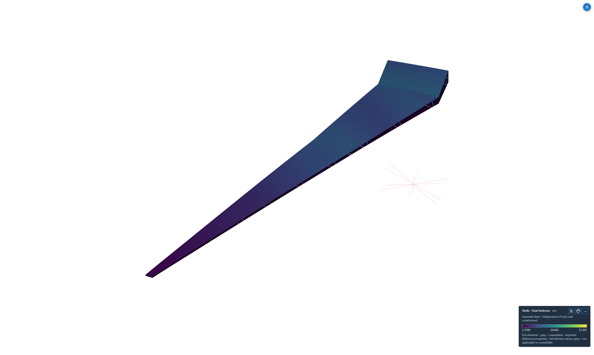
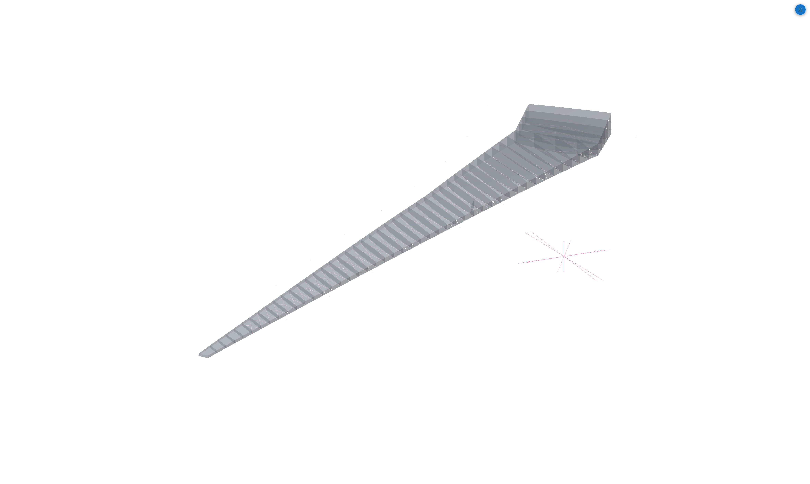

# Original uCRM9 wingbox structural validation

This case compares the released coarse uCRM9 structural model with its authors'
published structural reference solutions. It retains the anisotropic smeared
panel stiffnesses, mass distribution, rigid connections, boundary conditions and
fixed cruise loads. The numerical comparison and its limitations are in the
[case card](case_card.pdf), [results](results/comparison.json) and
[full-precision metrics](metrics.csv).

The completed SOL103 run returns all 20 requested finite modes. All 20 natural
frequencies are within 0.5% of the published coarse-model values; the largest
frequency error is **0.27339%**. Comparing angular eigenvalues, `(2πf)²`, gives
**19 of 20 within 0.5%**, with a maximum error of **0.54603%** in mode 1. A Sturm
count certifies the 20-mode interval; the largest original-pencil relative
residual is **4.14×10⁻¹¹**. These are distinct frequency and eigenvalue measures.

SOL101 gives vertical tip-rib displacements from **2.47251 to 2.5324511 m**.
The predeclared inferred observation, GRID 833, gives **2.4825351 m**, 1.63893%
below the published 2.5239 m scalar. The missing reference observation point
prevents a qualified static pass; all 21 tip nodes are retained in the results.

[Browse nine direct high-resolution Boxer views](figures/boxer/index.html), or
open the [native 20-mode result](results/SOL103/run_uCRM-9_modal_coarse.jfem).



## Model and reference

The right wingbox has 23,738 structural GRIDs, 25,055 CQUADR shells, 242 PSHELL
regions and 968 MAT2 cards. Separate material tensors define membrane, bending,
transverse shear and membrane/bending coupling. Stiffeners are smeared into these
properties; there are no discrete beam stringers. The original 74 added GRIDs,
74 concentrated masses, 12 RBE2 and 62 RBE3 connections remain present.

The source provides a 13-point engine mass cage, leading/trailing-edge masses
and 20% fuel. The engine cage retains its rotational inertia through its spatial
mass distribution. Source constraints include both the root and side-of-body
restraints; substituting a single clamp changes the model.

The independent targets are **2.5239 m vertical tip displacement and 20 natural
frequencies** from the coarse structural column of the authors' workbook.
[All 63 workbook values](published_structural_references.csv) also retain the
medium/fine reference columns and source cells. Those columns are author
solutions, rather than JFEM refinement runs. The separate coupled aeroelastic
value of 2.591 m is not used for the structural-only comparison.

The workbook does not identify a GRID or chord station for its tip displacement.
We report the predeclared inferred observation GRID 833 and every one of the 21
tip-rib GRIDs within 0.001 m of maximum span. No node is selected after finding
which response best matches the scalar. Ordered frequency comparisons do not
establish mode-shape identity because reference eigenvectors are not supplied.

## Run and inspect

From the shared JFEM repository environment:

```text
julia --startup-file=no --project=. validation/cases/CRM_uCRM9_published/reproduce.jl
```

The script runs the original static cruise and 20-mode wrappers, creates a fresh
`reruns` folder and preserves the published results. An optional first argument
selects another output folder. A modal result with fewer than 20 modes raises an
error and retains its diagnostics.

SOL101 combines the supplied fixed aerodynamic forces with gravity. SOL103 uses
the same original masses and constraints. The source cards include
`COUPMASS=-1`, `AUTOSPC=NO`, `K6ROT=1e5` and `WTMASS=1`. The current CQUADR route
uses JFEM's native TACS-formulation shell operator and the common constraint and
mass assembly. Source-control preservation does not imply identical element
formulations. In particular, this CQUADR operator uses its internal drilling
policy rather than passing `K6ROT` through as a CQUAD4 drilling multiplier.
Neither the workbook nor the wrappers identify the reference solver release.

Open available native modal `.jfem` output through **Project → Open JFEM
results** in Boxer. The source model views in `figures/boxer` are unedited 4K
screenshots from the actual app. Their sidecars preserve camera, lighting and
source information. Static translations and constraint reactions are retained
in JSON. Independent-material/MID4 PSHELL force and stress recovery is currently
unavailable; absent fields are not replaced by zero stress.



## Attribution and reproducibility

Model and reference data: Timothy R. Brooks, Gaetan G. W. Kenway and Joaquim R.
R. A. Martins, [uCRM: undeflected Common Research Model, version 1](https://data.mendeley.com/datasets/gpk4zn73xn/1)
(2019), DOI **10.17632/gpk4zn73xn.1**, licensed **CC BY 4.0**. Associated article:
[Benchmark Aerostructural Models for the Study of Transonic Aircraft Wings](https://doi.org/10.2514/1.J056603),
*AIAA Journal* 56(7), 2840–2855 (2018).

[Reference provenance](reference_provenance.json) binds the extracted source
members and reference workbook by hash. The complete archive was not downloaded;
selected ZIP members were retrieved by HTTP byte ranges and checked against
their ZIP CRC values. [Curation receipt](curation_receipt.json) records one
neutralized software-name comment in the static wrapper. Every active card and
INCLUDE path remains byte-identical to the original source used for the runs.
The unused full-fuel alternative is not included in either selected analysis.

These computational structural checks are separate from the
[uniform isotropic CRM illustration and regression model](../CRM_wingbox_modal/figures/boxer/index.html).

The investigation identified and corrected coupled-shell condensation and
reduced-shear quadrature defects. Independent energy tests and an audit of all
25,055 original shell stiffness matrices accompany the isolated source-element
[diagnostics](diagnostics/). The older uniform model remains a separate
five-mode regression control; its eigenvalues change by less than 1×10⁻⁸%.
